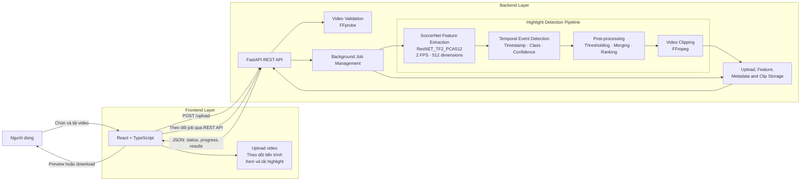
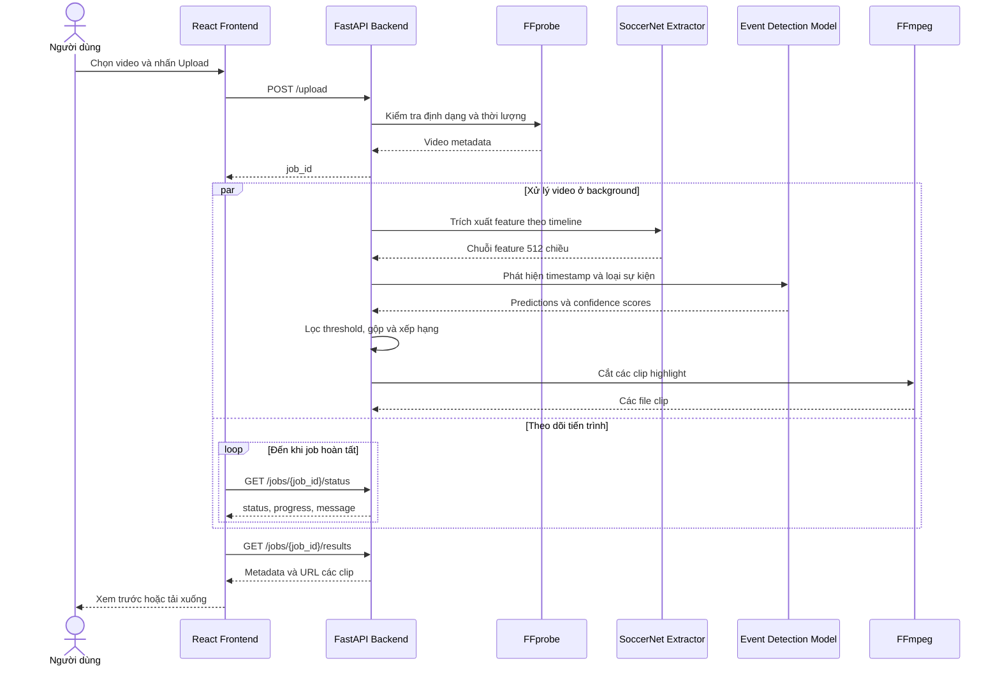

# Football Highlight Cutter

Football Highlight Cutter là hệ thống web hỗ trợ **tự động phát hiện các tình huống đáng chú ý trong video bóng đá và tạo clip highlight**. Người dùng tải video trận đấu lên, hệ thống xử lý ở backend, xác định thời điểm sự kiện, cắt các đoạn video tương ứng và trả kết quả để xem hoặc tải xuống.

## Chức năng chính

- Tải lên video bóng đá và xử lý bất đồng bộ.
- Phát hiện thời điểm của các sự kiện quan trọng trên timeline.
- Tự động cắt clip quanh từng sự kiện bằng FFmpeg.
- Hiển thị nhãn, độ tin cậy và thời gian của mỗi highlight.
- Xem trước, tải từng clip hoặc tải toàn bộ kết quả dưới dạng ZIP.
- Theo dõi tiến trình xử lý theo từng job.

## Các nhãn sự kiện

Giao diện hiển thị 6 nhóm sự kiện:

- `Goal`
- `Shot`
- `Corner`
- `DirectFreeKick`
- `Penalty`
- `Card`

Mô hình vẫn phân biệt nội bộ `ShotOnTarget` và `ShotOffTarget`, nhưng cả hai được hiển thị chung là `Shot` để kết quả dễ theo dõi hơn.

## Kiến trúc hệ thống

Sơ đồ dưới đây mô tả các thành phần chính và cách frontend, backend, mô hình AI và FFmpeg phối hợp với nhau.



### Trách nhiệm của từng thành phần

| Thành phần | Trách nhiệm chính |
|---|---|
| **Frontend** | Nhận video từ người dùng, gọi API, theo dõi tiến trình, hiển thị và tải highlight. |
| **FastAPI Backend** | Kiểm tra request, quản lý job nền, điều phối pipeline và cung cấp API kết quả. |
| **FFprobe** | Đọc metadata và kiểm tra thời lượng video trước khi xử lý. |
| **Feature Extractor** | Lấy mẫu video ở 2 FPS và chuyển mỗi thời điểm thành vector đặc trưng 512 chiều. |
| **Event Detection Model** | Phân tích chuỗi đặc trưng để dự đoán timestamp, loại sự kiện và độ tin cậy. |
| **Post-processing** | Lọc theo ngưỡng từng lớp, gộp các sự kiện gần nhau và xếp hạng highlight. |
| **FFmpeg** | Cắt video gốc thành các clip highlight theo khoảng thời gian đã chọn. |
| **Storage / Job Service** | Lưu video tạm, feature, metadata, clip đầu ra và trạng thái xử lý. |

## Luồng xử lý end-to-end



## Quy trình xử lý

```text
Video người dùng
→ kiểm tra định dạng và thời lượng bằng FFprobe
→ trích xuất đặc trưng hình ảnh bằng SoccerNet ResNET_TF2_PCA512
→ phát hiện timestamp và loại sự kiện
→ lọc theo threshold và gộp các dự đoán gần nhau
→ xếp hạng và chọn highlight
→ cắt clip bằng FFmpeg
→ trả metadata và clip về frontend
→ xem trước hoặc tải kết quả
```

## Công nghệ sử dụng

### Backend

- Python
- FastAPI
- PyTorch
- SoccerNet feature extractor
- FFmpeg / FFprobe

### Frontend

- React
- TypeScript
- Vite
- Axios

## Cấu trúc thư mục

```text
football-highlight-cutter/
├── backend/
│   ├── app/
│   │   ├── api/                 # Upload, job status và clip endpoints
│   │   ├── pipeline/            # Feature extraction, model và hậu xử lý
│   │   ├── services/            # FFmpeg, storage, job và cleanup services
│   │   └── utils/               # Tiện ích dùng chung
│   ├── data/                    # Upload, feature, output và file tạm
│   ├── model_artifacts/         # Checkpoint và cấu hình mô hình
│   ├── scripts/                 # Script thiết lập, kiểm tra và dọn dữ liệu
│   ├── tests/                   # Backend tests
│   ├── third_party/             # Tài nguyên SoccerNet được cố định phiên bản
│   ├── requirements.txt
│   └── RUN_GUIDE.md
├── frontend/
│   ├── src/
│   │   ├── api/                 # API client
│   │   ├── components/          # Component giao diện
│   │   ├── pages/               # Các trang chính
│   │   ├── styles/              # CSS
│   │   └── types/               # TypeScript types
│   ├── package.json
│   └── README.md
└── README.md
```

## Yêu cầu môi trường

Hướng dẫn được kiểm thử thực tế trên **Windows 11, PowerShell và Python 3.11**. Script cũng hỗ trợ Python 3.10 và 3.12, nhưng Python 3.11 được ưu tiên vì đây là cấu hình đã chạy end-to-end.

Cần cài trước:

- Git.
- Python **3.10, 3.11 hoặc 3.12**. Máy có thể đồng thời cài Python mới hơn; `setup.ps1` sẽ tự chọn phiên bản tương thích bằng Windows Python Launcher.
- Miniconda hoặc Anaconda.
- Node.js **20.19+ hoặc 22.12+**.
- FFmpeg và FFprobe trong biến môi trường `PATH`.

Kiểm tra nhanh:

```powershell
git --version
py -0p
conda --version
node --version
npm --version
ffmpeg -version
ffprobe -version
```

Ví dụ máy có Python 3.14 làm mặc định và Python 3.11 cài song song vẫn chạy được. Script sẽ ưu tiên lần lượt Python 3.11, 3.12 rồi 3.10; nó không dùng nhầm Python 3.13 hoặc 3.14 để tạo backend `.venv`.

Checkpoint và threshold cần tồn tại tại:

```text
backend/model_artifacts/spotter_v2/best_model.pt
backend/model_artifacts/spotter_v2/best_thresholds.json
```

Hai file này là thành phần bắt buộc của bản chạy thật và phải được commit lên repository. 
Không xóa `best_model.pt` khi dọn source để push.

## Cách khuyến nghị — Thiết lập tự động

### 1. Clone repository

```powershell
git clone https://github.com/Kh4nq/football-highlight-detecter.git
cd football-highlight-detecter
```

### 2. Chạy setup lần đầu

```powershell
powershell -ExecutionPolicy Bypass -File .\setup.ps1
```

Script sẽ tự động:

- chọn một Python tương thích trong các bản 3.10–3.12;
- tạo hoặc sửa lại `backend\.venv`;
- cài `backend\requirements.txt`;
- tạo hoặc cập nhật Conda environment `SoccerNet-FeatureExtraction`;
- kiểm tra TensorFlow, SoccerNet, OpenCV, OpenSSL và các dependency extractor;
- chuẩn bị các file extractor và tải trước ResNet-152 weights;
- cài frontend theo `package-lock.json` bằng `npm ci` và chạy `npm run build` để kiểm tra;
- chạy preflight backend cuối cùng.

Kết quả thành công kết thúc bằng:

```text
Setup completed successfully.
```

### 3. Chạy dự án

```powershell
powershell -ExecutionPolicy Bypass -File .\run.ps1
```

Script mở hai cửa sổ PowerShell riêng cho backend và frontend, sau đó mở trình duyệt. Giữ cả hai cửa sổ này mở trong khi sử dụng hệ thống; đóng một cửa sổ sẽ dừng thành phần tương ứng.

```text
Frontend: http://localhost:5173
Backend:  http://localhost:8000
Health:   http://localhost:8000/health
```

Những lần sau chỉ cần chạy `run.ps1`; không cần chạy lại setup trừ khi dependency hoặc cấu hình môi trường thay đổi.

## Cách thủ công — Dành cho kiểm tra và xử lý lỗi

### 1. Chọn Python backend tương thích

Liệt kê các bản Python:

```powershell
py -0p
```

Tạo `.venv` bằng một bản từ 3.10 đến 3.12, ví dụ Python 3.11:

```powershell
cd backend
py -3.11 -m venv .venv
.\.venv\Scripts\Activate.ps1
python -m pip install --upgrade pip
pip install -r requirements.txt
```

Không dùng Python 3.13 hoặc 3.14 cho backend hiện tại.

### 2. Tạo hoặc cập nhật SoccerNet environment

```powershell
conda env create -f environment.soccernet.yml
```

Nếu environment đã tồn tại:

```powershell
conda env update -n SoccerNet-FeatureExtraction -f environment.soccernet.yml --prune
```

Chuẩn bị extractor:

```powershell
.\.venv\Scripts\python.exe .\scripts\setup_soccernet_extractor.py
```

Kiểm tra runtime bằng Conda:

```powershell
conda run --no-capture-output -n SoccerNet-FeatureExtraction python -c "import ssl, tensorflow, SoccerNet, cv2, skvideo, imutils, sklearn; print('Extractor runtime OK'); print(ssl.OPENSSL_VERSION)"
```

Backend mặc định gọi extractor bằng `conda run`, vì vậy không cần tìm hoặc khai báo thủ công `SOCCERNET_EXTRACTOR_PYTHON`.

### 3. Cài frontend

Mở terminal tại thư mục `frontend`:

```powershell
npm install
npm run dev
```

### 4. Chạy backend thủ công

Mở terminal tại thư mục `backend`:

```powershell
.\.venv\Scripts\Activate.ps1
$env:SOCCERNET_EXECUTION_MODE="conda"
$env:SOCCERNET_CONDA_ENV="SoccerNet-FeatureExtraction"
$env:SOCCERNET_GPU="-1"
python -m uvicorn app.main:app --reload
```

Backend mặc định chạy tại:

```text
http://localhost:8000
```

Tài liệu API:

```text
http://localhost:8000/docs
```


## Source sạch để push lên GitHub

Các thư mục sinh ra khi setup/chạy đã được `.gitignore` loại trừ:

```text
backend/.venv/
frontend/node_modules/
frontend/dist/
backend/data/uploads/*
backend/data/features/*
backend/data/outputs/*
backend/data/temp/*
__pycache__/
.pytest_cache/
```

Không cần xóa các thư mục trên khỏi máy trước khi commit; chỉ cần kiểm tra `git status` để chắc chắn chúng không được staged. 
Checkpoint `backend/model_artifacts/spotter_v2/best_model.pt`, threshold JSON, PCA files, `package-lock.json`, `environment.soccernet.yml`, `setup.ps1` và `run.ps1` phải được giữ lại trong repository.

## API chính

| Method | Endpoint | Mô tả |
|---|---|---|
| `POST` | `/upload` | Tải video lên và tạo job xử lý |
| `GET` | `/jobs/{job_id}/status` | Theo dõi trạng thái và tiến trình |
| `GET` | `/jobs/{job_id}/results` | Lấy metadata các highlight |
| `GET` | `/clips/{clip_id}` | Xem một clip; thêm `?download=true` để tải xuống |
| `GET` | `/jobs/{job_id}/download-all` | Tải toàn bộ clip dưới dạng ZIP |
| `DELETE` | `/jobs/{job_id}` | Xóa dữ liệu và kết quả của một job |
| `GET` | `/health` | Kiểm tra mức sẵn sàng của hệ thống |

## Kết quả đầu ra

Mỗi highlight có các thông tin chính:

- thời điểm bắt đầu và kết thúc clip;
- thời điểm sự kiện chính;
- nhãn hiển thị;
- độ tin cậy của highlight;
- độ tin cậy của nhãn;
- đường dẫn clip;
- nhãn chi tiết phục vụ kiểm tra mô hình, khi có.

Ví dụ metadata rút gọn:

```json
{
  "clip_id": "<job_id>_shot_01",
  "start": 2196.0,
  "end": 2212.0,
  "peak_second": 2204.465,
  "label": "Shot",
  "fine_label": "ShotOffTarget",
  "highlight_confidence": 0.234802,
  "label_confidence": 0.983682,
  "clip_url": "/clips/<job_id>_shot_01"
}
```

## Giới hạn hiện tại

- Chất lượng dự đoán phụ thuộc vào góc quay, chất lượng hình ảnh và phong cách dựng video.
- Video highlight đã biên tập mạnh có thể khác đáng kể so với video phát sóng đầy đủ.
- Một số sự kiện diễn ra sát nhau có thể được gộp thành cùng một clip.
- Thời gian xử lý phụ thuộc vào độ dài video và cấu hình máy.
